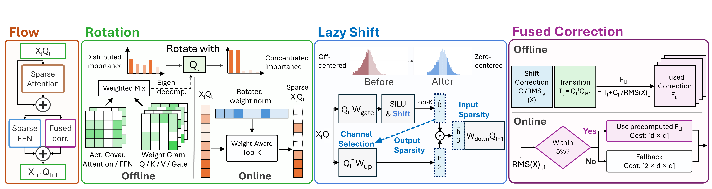

# RoShift
### LLM 추론의 활성화 희소성을 위한 Lazy Shift와 Weight-aware Rotation

**Geunsoo Song · Jiwon Seo · Hoeseok Yang · Youngmin Yi**

[빠른 시작](#빠른-시작) · [정확도](docs/ACCURACY.ko.md) · [속도 측정](docs/SPEEDUP.ko.md)



RoShift는 별도의 학습 없이 활성화 희소성을 활용해 LLM 디코딩을 가속합니다. Lazy shift와 활성화 및 가중치 정보를 함께 고려하는 회전으로 희소화에 유리한 표현을 만들고, 효율적인 CUDA/Triton 커널로 실제 디코딩 속도를 높입니다.

이 저장소에는 calibration, 희소도 배분, 회전 탐색, 정확도 평가, GPU 디코딩을 위한 코드가 포함되어 있습니다.

**지원 모델:** Llama-3.1-8B, Llama-2-7B, Mistral-7B, Qwen2.5-7B, Qwen3-8B-Base.

## 빠른 시작

데스크톱 버전은 Linux/WSL, Python 3.12, CUDA 12.8 기반 PyTorch 2.10을 기준으로 구성되어 있습니다. 저장소 최상위 디렉터리에서 다음 명령을 실행해 주세요.

```bash
python3.12 -m venv .venv
source .venv/bin/activate
python -m pip install torch==2.10.0 --index-url https://download.pytorch.org/whl/cu128
python -m pip install -r environments/accuracy.txt -r environments/speedup.txt
python -m pip install .
roshift check
```

`ROSHIFT_DATA`에는 쓰기 권한이 있는 데이터 디렉터리를 지정해 주세요. 초기 calibration에는 최소 80 GiB의 여유 공간이 필요합니다. 접근 승인이 필요한 모델은 먼저 사용 권한을 얻은 뒤 `hf auth login`으로 로그인해 주세요.

## 사용법

먼저 Llama-3.1-8B에서 희소도 50%로 소규모 정확도 평가를 실행해 보실 수 있습니다.

```bash
export ROSHIFT_DATA=/data/roshift
roshift accuracy run --model llama31 --method roshift --allocation uniform \
  --sparsity 50 --tasks BoolQ --limit 8 --data-dir "$ROSHIFT_DATA" --execute
```

전체 벤치마크 평가와 디코딩 속도 측정 방법은 [정확도 가이드](docs/ACCURACY.ko.md)와 [속도 측정 가이드](docs/SPEEDUP.ko.md)에서 확인하실 수 있습니다. Jetson을 사용하신다면 별도의 [Orin 가이드](docs/ORIN.ko.md)를 참고해 주세요.

## 인용

저희 연구나 코드가 도움이 되었다면, 논문 인용을 고려해 주세요.

```bibtex
@misc{song2026roshift,
  title={RoShift: Lazy Shift and Weight-aware Rotation for Activation Sparsity in LLM Inference},
  author={Song, Geunsoo and Seo, Jiwon and Yang, Hoeseok and Yi, Youngmin},
  year={2026}
}
```

## 라이선스

RoShift의 자체 코드는 [MIT 라이선스](LICENSE)로 공개되어 있습니다. 제3자 구성 요소에는 각각의 라이선스가 적용됩니다. 자세한 내용은 [제3자 고지](third_party/README.md)를 참고해 주세요.
