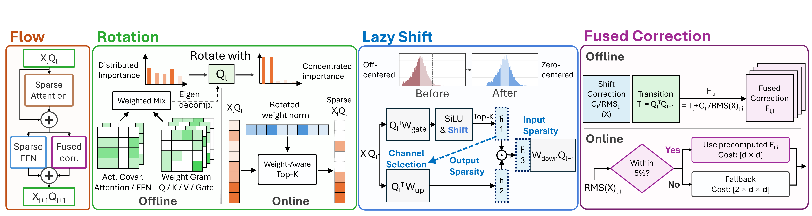

# RoShift
### Lazy Shift and Weight-aware Rotation for Activation Sparsity in LLM Inference

**Geunsoo Song · Jiwon Seo · Hoeseok Yang · Youngmin Yi**

[Paper (arXiv)](https://arxiv.org/abs/2611.20549) · [Quick Start](#quick-start) · [Accuracy](docs/ACCURACY.md) · [Speedup](docs/SPEEDUP.md)



RoShift accelerates LLM decoding through training-free activation sparsity. It combines lazy shift and activation- and weight-aware rotation to obtain sparsity-friendly representations, with efficient CUDA/Triton kernels that translate these gains into decoding speedup.

This repository provides calibration, sparsity allocation, rotation search, accuracy evaluation, and GPU decoding implementations.

**Supported models:** Llama-3.1-8B, Llama-2-7B, Mistral-7B, Qwen2.5-7B, and Qwen3-8B-Base.

## Quick Start

The desktop implementation uses Linux/WSL, Python 3.12, and PyTorch 2.10 with CUDA 12.8. Run the following from the repository root:

```bash
python3.12 -m venv .venv
source .venv/bin/activate
python -m pip install torch==2.10.0 --index-url https://download.pytorch.org/whl/cu128
python -m pip install -r environments/accuracy.txt -r environments/speedup.txt
python -m pip install .
roshift check
```

Set `ROSHIFT_DATA` to a writable data directory with at least 80 GiB free for initial calibration. For gated models, obtain access and run `hf auth login`.

## Usage

A small accuracy run on Llama-3.1-8B at 50% sparsity:

```bash
export ROSHIFT_DATA=/data/roshift
roshift accuracy run --model llama31 --method roshift --allocation uniform \
  --sparsity 50 --tasks BoolQ --limit 8 --data-dir "$ROSHIFT_DATA" --execute
```

For full benchmark evaluation and decoding-speed measurements, see the [Accuracy Guide](docs/ACCURACY.md) and [Speedup Guide](docs/SPEEDUP.md). Jetson users should follow the separate [Orin Guide](docs/ORIN.md).

## Citation

If you find our work or code useful, please consider citing our paper.

```bibtex
@misc{song2026roshift,
  title={RoShift: Lazy Shift and Weight-aware Rotation for Activation Sparsity in LLM Inference},
  author={Song, Geunsoo and Seo, Jiwon and Yang, Hoeseok and Yi, Youngmin},
  year={2026},
  eprint={2611.20549},
  archivePrefix={arXiv},
  primaryClass={cs.LG},
  url={https://arxiv.org/abs/2611.20549}
}
```

## License

Original RoShift code is released under the [MIT License](LICENSE). Third-party components retain their respective licenses; see [Third-party Notices](third_party/README.md).
